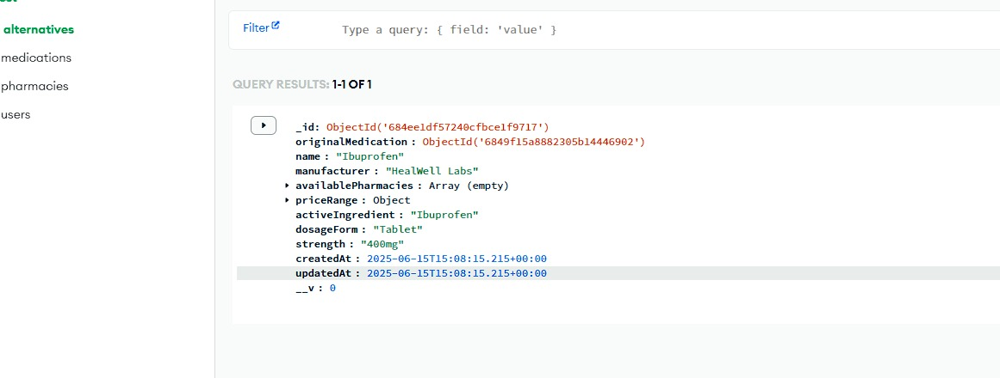

# Alternative Medications Directory API

> **Course project** - Software Development Frameworks (SDEV 3308), Islamic University of Gaza, 2025 - Individual project by Reem Abd-ElQader


A comprehensive backend API system for managing medications, alternatives, and pharmacies with role-based authentication and interactive documentation.

## Features

- **Authentication & Authorization**: JWT-based admin authentication
- **Medications Management**: CRUD operations for medications
- **Alternatives Management**: Manage medication alternatives with pricing
- **Pharmacy Management**: Complete pharmacy information system
- **Interactive API Documentation**: Swagger/OpenAPI UI
- **Security**: Rate limiting, input validation, and comprehensive error handling
- **Logging**: Winston-based logging system
- **Database**: MongoDB with Mongoose ODM

## Technology Stack

- **Runtime**: Node.js (Latest LTS)
- **Framework**: Express.js
- **Database**: MongoDB with Mongoose
- **Authentication**: JWT (JSON Web Tokens)
- **Validation**: Joi
- **Documentation**: Swagger/OpenAPI
- **Security**: Helmet, CORS, Rate Limiting
- **Logging**: Winston

## Quick Start

### Prerequisites

- Node.js (v18 or higher)
- MongoDB (local or cloud instance)

### Installation

1. **Clone and install dependencies**:
   ```bash
   npm install
   ```

2. **Environment Setup**:
   ```bash
   cp .env.example .env
   ```
   
   Edit `.env` file with your configuration:
   ```env
   PORT=3010
   NODE_ENV=development
   MONGODB_URI=mongodb://localhost:27017/medications_directory
   JWT_SECRET=your-super-secret-jwt-key-change-this-in-production
   JWT_EXPIRES_IN=24h
   ADMIN_EMAIL=admin@medications.com
   ADMIN_PASSWORD=change-me
   ```

3. **Start the server**:
   ```bash
   # Development mode with auto-reload
   npm run dev
   
   # Production mode
   npm start
   ```

4. **Access the API**:
   - API Base URL: `http://localhost:3010/api`
   - Interactive Documentation: `http://localhost:3010/api-docs`
   - Health Check: `http://localhost:3010/api/health`

## API Endpoints

### Authentication
- `POST /api/auth/login` - Admin login
- `POST /api/auth/logout` - Session termination
- `GET /api/auth/verify` - Token verification

### Medications
- `GET /api/medications` - List all medications (with pagination & filters)
- `GET /api/medications/:id` - Get specific medication
- `POST /api/medications` - Create new medication
- `PUT /api/medications/:id` - Update medication
- `DELETE /api/medications/:id` - Remove medication

### Alternatives
- `GET /api/alternatives` - List all alternatives (with pagination & filters)
- `GET /api/alternatives/:id` - Get specific alternative
- `POST /api/alternatives` - Create alternative
- `PUT /api/alternatives/:id` - Update alternative
- `DELETE /api/alternatives/:id` - Remove alternative

### Pharmacies
- `GET /api/pharmacies` - List all pharmacies (with pagination & filters)
- `GET /api/pharmacies/:id` - Get specific pharmacy
- `POST /api/pharmacies` - Add new pharmacy
- `PUT /api/pharmacies/:id` - Update pharmacy
- `DELETE /api/pharmacies/:id` - Remove pharmacy

## Authentication

All API endpoints (except login) require JWT authentication. Include the token in the Authorization header:

```
Authorization: Bearer <your-jwt-token>
```

### Default Admin Credentials
- **Email**: `admin@medications.com`
- **Password**: `change-me`

**⚠️ Important**: Change the default password after first login!

## Data Models

### Medication Schema
```javascript
{
  name: String (required),
  manufacturer: String (required),
  category: String (required, enum),
  status: String (enum: available/unavailable),
  description: String,
  activeIngredient: String,
  dosageForm: String,
  strength: String,
  timestamps: true
}
```

### Alternative Schema
```javascript
{
  originalMedication: ObjectId (ref: Medication, required),
  name: String (required),
  manufacturer: String (required),
  availablePharmacies: [ObjectId] (ref: Pharmacy),
  priceRange: {
    min: Number (required),
    max: Number (required),
    currency: String (default: USD)
  },
  activeIngredient: String,
  dosageForm: String,
  strength: String,
  notes: String,
  timestamps: true
}
```

### Pharmacy Schema
```javascript
{
  name: String (required),
  location: {
    address: String (required),
    city: String (required),
    state: String (required),
    zipCode: String (required),
    coordinates: { latitude: Number, longitude: Number }
  },
  contactInfo: {
    phone: String (required),
    email: String,
    website: String
  },
  operatingHours: Object,
  services: [String] (enum),
  isActive: Boolean (default: true),
  timestamps: true
}
```

## API Usage Examples

### Login
```bash
curl -X POST http://localhost:3010/api/auth/login \
  -H "Content-Type: application/json" \
  -d '{"email": "admin@medications.com", "password": "change-me"}'
```

### Create Medication
```bash
curl -X POST http://localhost:3010/api/medications \
  -H "Content-Type: application/json" \
  -H "Authorization: Bearer <your-token>" \
  -d '{
    "name": "Aspirin",
    "manufacturer": "Bayer",
    "category": "Pain Relief",
    "activeIngredient": "Acetylsalicylic acid",
    "dosageForm": "Tablet",
    "strength": "325mg"
  }'
```

### Get Medications with Filters
```bash
curl "http://localhost:3010/api/medications?category=Pain%20Relief&page=1&limit=10" \
  -H "Authorization: Bearer <your-token>"
```

## Security Features

- **Rate Limiting**: 100 requests per 15 minutes per IP
- **Input Validation**: Joi schema validation for all inputs
- **Authentication**: JWT-based with configurable expiration
- **Authorization**: Role-based access control (Admin only)
- **Security Headers**: Helmet.js for security headers
- **CORS**: Configurable cross-origin resource sharing
- **Error Handling**: Comprehensive error handling and logging

## Development

### Project Structure
```
src/
├── config/          # Configuration files
├── middleware/      # Custom middleware
├── models/          # Database models
├── routes/          # API routes
├── utils/           # Utility functions
└── server.js        # Main server file
```

### Available Scripts
- `npm start` - Start production server
- `npm run dev` - Start development server with nodemon
- `npm test` - Run tests (Jest)

### Logging
Logs are stored in the `logs/` directory:
- `error.log` - Error level logs only
- `combined.log` - All logs

## Production Deployment

1. **Environment Variables**: Set all required environment variables
2. **Database**: Ensure MongoDB is accessible
3. **Security**: 
   - Change default admin credentials
   - Use strong JWT secret
   - Configure rate limiting appropriately
   - Set up HTTPS
4. **Monitoring**: Set up log monitoring and health checks

## API Documentation

Interactive Swagger documentation is available at `/api-docs` when the server is running. This provides:

- Complete API reference
- Request/response schemas
- Interactive testing interface
- Authentication setup
- Example requests and responses

## Support

For issues and questions:
- Check the interactive API documentation at `/api-docs`
- Review the logs in the `logs/` directory
- Ensure all environment variables are properly configured
- Verify MongoDB connection

## License

MIT License - see LICENSE file for details.

## Screenshots
| MongoDB collections | Swagger docs |
|---|---|
|  | [API docs (PDF)](db_screenshots/alt-pharma-api.pdf) |
